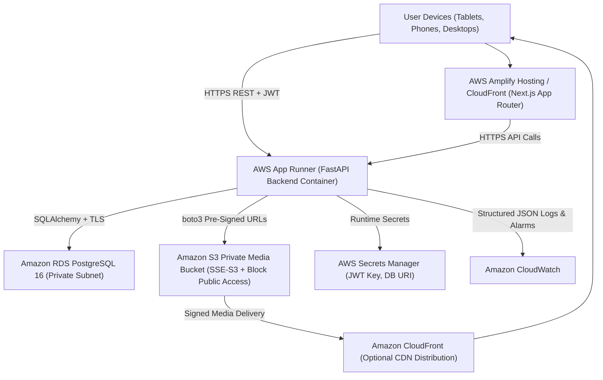

# LittleSteps — System Architecture

## 1. High-Level Cloud Architecture

LittleSteps follows a clean, three-tier cloud-native web architecture designed for high availability, strong child data protection, and low operational cost on Amazon Web Services (AWS).

---

## 2. Application Layering

### Frontend (`frontend/` — Next.js App Router + TypeScript)
- **App Router Pages**: Dedicated route segments per role (`/kids`, `/parent`, `/teacher`, `/admin`, `/login`, `/register`).
- **API Client (`src/services/api.ts`)**: Single typed HTTP wrapper handling `Authorization: Bearer` tokens and single-flight refresh token rotation on `401 Unauthorized`.
- **Auth Context (`src/hooks/useAuth.tsx`)**: Manages authenticated user state, selected active child profile, and role-based route protection (`ProtectedRoute`).
- **Child-Safe Navigation (`KidsNav`)**: Removes external links, hides adult tables/settings, provides Web Speech API audio narration, and enforces a **Grown-Up Gate** math prompt before returning to parent/teacher portals.

### Backend (`backend/` — FastAPI + SQLAlchemy 2.0 + Alembic)
- **Cloud Runtime & Health (`app/core/`, `app/api/routes/health.py`)**:
  - `hydrate_settings_from_aws_secrets`: Optional AWS Secrets Manager hydration (`AWS_SECRETS_MANAGER_ARN`) outside `test` mode.
  - `validate_production_config`: Enforces strong JWT keys, non-SQLite databases, strict CORS origins, and valid S3 configuration when `APP_ENV=production`.
  - `/api/health` & `/api/health/ready`: Live database (`SELECT 1`) and storage backend (`head_bucket` / local upload check) probes for App Runner and ALB targets.
- **Middleware Layer (`app/middleware/`)**:
  - `RequestLoggingMiddleware`: Propagates/generates `X-Request-ID` headers and logs sanitized single-line JSON HTTP events (`CloudWatchJsonFormatter`) without child PII or tokens.
  - `SecurityHeadersMiddleware`: Enforces `X-Content-Type-Options: nosniff`, `X-Frame-Options: DENY`, `Referrer-Policy`, restrictive `Permissions-Policy`, and HSTS in production.
  - `RateLimitMiddleware`: Sliding-window IP rate limiting to mitigate brute-force login attempts (exempting `/api/health` and `/api/health/ready`).
- **Dependency & RBAC Layer (`app/api/deps.py`)**:
  - `get_current_user`: Validates JWT signature, expiration, token type (`access`), and active user flag.
  - `require_roles(...)`: Enforces role authorization (`admin`, `teacher`, `parent`).
  - `verify_child_access(...)`: Verifies object-level authorization — parents can only query linked children (`parent_child_relationships`), teachers can only query students enrolled in their assigned classes (`teacher_class_assignments` + `class_enrollments`), and admins have governance access.
- **Service & Repository Layer (`app/services/`, `app/repositories/`)**: Isolates business rules, password hashing (`bcrypt`), SHA-256 refresh token hashing, storage abstraction (`Local` vs `S3`), and audit logging from HTTP transport handlers.

---

## 3. Child Privacy & Security Architecture (RA 10173 / COPPA-Aligned)

Because LittleSteps serves children aged **4–6**, privacy and safety are built into the data model and request flow:

1. **Parent-Controlled Learner Profiles**: Children never register independently, hold passwords, or manage credentials. A verified parent/guardian registers with explicit privacy consent (`privacy_consent_accepted_at`) and launches **Kids Mode** from their authenticated session.
2. **Data Minimization**: The `children` table stores only a `display_name` (nickname/first name), `birth_year`, `age_group`, avatar key, and learning preferences — no full legal name, home address, email, or phone number for a child.
3. **Zero Child PII in URLs, Logs, or Public Storage**:
   - Child resources are addressed by opaque UUIDs (`child_id`), never names.
   - `audit_logs` record actor user ID, action type, and resource UUID without logging child personal data.
   - All media assets live in a **private S3 bucket** (`BlockPublicAcls: true`) accessed via short-lived pre-signed URLs.
4. **No Child-to-Child Social Features or Ads**: There are no public profiles, chat rooms, leaderboards comparing children, or third-party ad trackers.
5. **Philippine Data Privacy Act (RA 10173) Alignment**: Mandatory explicit guardian consent at registration, purpose-limited data fields, role-scoped access control, secure password/token cryptography, and auditability of administrative changes.
