# LittleSteps — Database ERD & Normalized Schema (40 Tables)

All 40 tables use UUID string primary keys (`VARCHAR(36)`), strict foreign keys (`PRAGMA foreign_keys=ON` in SQLite, native FK constraints in PostgreSQL 16), explicit `ON DELETE` behaviors, indexes on lookup columns, and UTC `created_at` / `updated_at` timestamps.

---

## 1. Entity Relationship Diagram

```mermaid
erDiagram
    users ||--o{ user_roles : has
    roles ||--o{ user_roles : assigned_to
    users ||--o| parent_profiles : owns
    users ||--o| teacher_profiles : owns
    users ||--o| admin_profiles : owns
    users ||--o{ refresh_tokens : holds

    users ||--o{ parent_child_relationships : manages
    children ||--o{ parent_child_relationships : linked_to
    classes ||--o{ class_enrollments : contains
    children ||--o{ class_enrollments : enrolled_in
    users ||--o{ teacher_class_assignments : teaches
    classes ||--o{ teacher_class_assignments : staffed_by

    subjects ||--o{ lessons : groups
    themes ||--o{ learning_objectives : defines
    themes ||--o| parent_guides : includes
    themes ||--o{ home_activities : suggests
    themes ||--o{ lessons : organizes
    lessons ||--o{ activities : contains
    lessons ||--o{ lesson_resources : attaches
    themes ||--o{ worksheets : provides
    themes ||--o{ games : links
    lessons ||--o{ quizzes : assesses
    quizzes ||--o{ quiz_questions : asks

    children ||--o{ lesson_progress : completes
    children ||--o{ activity_attempts : plays
    children ||--o{ quiz_results : submits
    children ||--o{ skill_progress : builds
    children ||--o{ child_rewards : earns
    children ||--o{ child_artworks : saves
    children ||--o{ home_activity_progress : practices
    users ||--o{ parent_reflections : writes
    children ||--o{ learning_goals : targets
    users ||--o{ teacher_observations : records
```

---

## 2. Complete Table Dictionary (40 Tables)

### Authentication & Profiles (7 tables)
1. **`users`**: Core account (`id`, `email` unique, `password_hash`, `full_name`, `is_active`, `privacy_consent_accepted_at`, `last_login_at`).
2. **`roles`**: Canonical roles (`id`, `name`: `admin` | `teacher` | `parent`, `description`).
3. **`user_roles`**: Many-to-many join (`user_id` FK -> `users.id` CASCADE, `role_id` FK -> `roles.id` CASCADE, unique `(user_id, role_id)`).
4. **`refresh_tokens`**: Rotating hashed refresh tokens (`user_id` FK CASCADE, `token_hash` unique, `expires_at`, `revoked_at`).
5. **`parent_profiles`**: Guardian preferences (`user_id` unique FK CASCADE, `preferred_language`, `daily_screen_limit_mins`, `notifications_enabled`).
6. **`teacher_profiles`**: Educator metadata (`user_id` unique FK CASCADE, `employee_code`, `specialization`, `bio`).
7. **`admin_profiles`**: Administrator metadata (`user_id` unique FK CASCADE, `department`, `title`).

### Learners & Classes (5 tables)
8. **`children`**: Child-safe learner record (`display_name`, `birth_year`, `age_group`, `avatar_key`, `favorite_color`, `mascot_name`, `daily_goal_minutes`, `streak_days`, `total_stars`, `is_active`, `last_activity_date`). Zero personal email/phone/address.
9. **`parent_child_relationships`**: Guardian ownership (`parent_user_id` FK CASCADE, `child_id` FK CASCADE, `relationship_type`, `is_primary`).
10. **`classes`**: Kindergarten sections (`name`, `age_group`, `academic_year`, `room_label`, `is_active`).
11. **`class_enrollments`**: Student-to-class mapping (`class_id` FK CASCADE, `child_id` FK CASCADE, `status`).
12. **`teacher_class_assignments`**: Teacher-to-class mapping (`teacher_user_id` FK CASCADE, `class_id` FK CASCADE, `is_lead`).

### Curriculum & Content (11 tables)
13. **`subjects`**: 6 core preschool domains (`slug` unique, `name`, `description`, `icon_key`, `color_hex`, `sort_order`).
14. **`themes`**: 12 weekly themes (`week_number` unique, `slug` unique, `title`, `summary`, `color_hex`, `status`, `published_at`, `created_by`).
15. **`learning_objectives`**: Specific goals per theme (`theme_id` FK CASCADE, `subject_id` FK SET NULL, `statement`, `sort_order`).
16. **`lessons`**: Interactive lessons (`subject_id` FK RESTRICT, `theme_id` FK SET NULL, `slug` unique, `title`, `summary`, `content_json`, `age_group`, `estimated_minutes`, `audio_narration_text`, `status`).
17. **`activities`**: Lesson sub-activities (`lesson_id` FK CASCADE, `title`, `activity_type`, `instructions`, `payload_json`, `sort_order`).
18. **`games`**: 10 reusable educational game templates (`slug` unique, `title`, `game_type`, `subject_id` FK RESTRICT, `theme_id` FK SET NULL, `instructions`, `difficulty_level`, `config_json`, `status`).
19. **`quizzes`**: Gentle check-ins (`lesson_id` FK SET NULL, `theme_id` FK SET NULL, `title`, `instructions`, `passing_stars`).
20. **`quiz_questions`**: Visual quiz prompts (`quiz_id` FK CASCADE, `prompt`, `options_json`, `correct_option_index`, `encouragement_text`, `sort_order`).
21. **`lesson_resources`**: S3/local media attachments (`lesson_id` FK CASCADE, `title`, `resource_type`, `storage_key`, `mime_type`, `file_size_bytes`).
22. **`worksheets`**: Printable PDFs/guides (`theme_id` FK CASCADE, `title`, `description`, `storage_key`, `age_group`).
23. **`parent_guides`**: Practical Home Learning Hub guides (`theme_id` unique FK CASCADE, `what_child_learns`, `why_it_matters`, `materials_needed_json`, `conversation_prompts_json`, `learning_tip`, `estimated_duration_mins`, `teacher_notes`).

### Progress & Rewards (7 tables — including `assignments`)
24. **`lesson_progress`**: Child lesson status (`child_id` FK CASCADE, `lesson_id` FK CASCADE, `status`, `completion_pct`, `stars_earned`, `time_spent_seconds`, `completed_at`).
25. **`activity_attempts`**: Game/activity play logs (`child_id` FK CASCADE, `activity_id` FK SET NULL, `game_id` FK SET NULL, `score_pct`, `stars_earned`, `attempts_count`, `duration_seconds`, `completed`).
26. **`quiz_results`**: Gentle quiz outcomes (`child_id` FK CASCADE, `quiz_id` FK CASCADE, `score_pct`, `stars_earned`, `answers_json`).
27. **`skill_progress`**: Mastery per skill/subject (`child_id` FK CASCADE, `subject_id` FK CASCADE, `skill_name`, `mastery_pct`, `practice_count`).
28. **`child_rewards`**: Earned badges/stars (`child_id` FK CASCADE, `badge_key`, `title`, `description`, `stars_value`, `awarded_at`).
29. **`child_artworks`**: Saved creative canvas pieces (`child_id` FK CASCADE, `title`, `storage_key`, `palette_used_json`, `approved_by_parent`).
30. **`assignments`**: Teacher-assigned lessons/activities to a class or child (`teacher_user_id` FK CASCADE, `class_id` FK SET NULL, `child_id` FK SET NULL, `lesson_id` FK SET NULL, `game_id` FK SET NULL, `title`, `due_date`).

### Parent Involvement (4 tables)
31. **`home_activities`**: Screen-free family activities (`theme_id` FK CASCADE, `title`, `instructions_json`, `materials_json`, `estimated_minutes`, `sort_order`).
32. **`home_activity_progress`**: Completion status per child (`child_id` FK CASCADE, `home_activity_id` FK CASCADE, `parent_user_id` FK CASCADE, `completed`, `completed_at`).
33. **`parent_reflections`**: Guardian notes on home learning (`parent_user_id` FK CASCADE, `child_id` FK CASCADE, `theme_id` FK CASCADE, `enjoyed`, `easy_concepts`, `challenging_concepts`, `discovery_notes`).
34. **`learning_goals`**: Weekly targets set by guardians (`child_id` FK CASCADE, `parent_user_id` FK CASCADE, `title`, `target_minutes_per_day`, `target_lessons_per_week`, `is_active`).

### Teacher Management (3 tables)
35. **`teacher_observations`**: Classroom notes (`teacher_user_id` FK CASCADE, `child_id` FK CASCADE, `class_id` FK SET NULL, `category`, `observation_text`, `observed_at`).
36. **`teacher_feedback`**: Parent-teacher communication (`teacher_user_id` FK CASCADE, `parent_user_id` FK CASCADE, `child_id` FK CASCADE, `message`, `is_read`).
37. **`announcements`**: Class or school announcements (`author_user_id` FK CASCADE, `class_id` FK SET NULL, `title`, `body`, `published_at`).

### System & Security (3 tables)
38. **`notifications`**: User alerts (`user_id` FK CASCADE, `title`, `message`, `category`, `is_read`, `read_at`).
39. **`audit_logs`**: Security & admin audit trail (`actor_user_id` FK SET NULL, `action`, `resource_type`, `resource_id`, `details_json`, `ip_address`). Contains zero child PII.
40. **`platform_settings`**: Configurable system flags (`key` unique, `value_json`, `description`).

---

## 3. Role-Based Data Isolation Rules

- **Parents (`parent`)**: May only read/update `children` linked via `parent_child_relationships`. Queries against unrelated child UUIDs return `403 Forbidden`.
- **Teachers (`teacher`)**: May only read `children` enrolled in classes linked to the teacher via `teacher_class_assignments` + `class_enrollments`.
- **Admins (`admin`)**: Full governance access with sensitive actions recorded in `audit_logs`.
